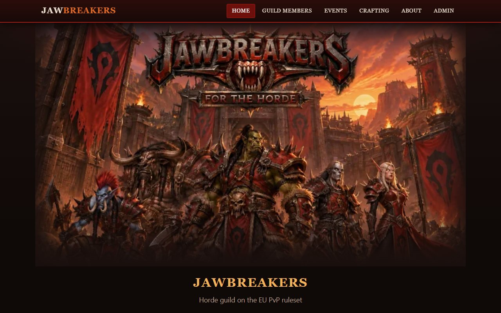
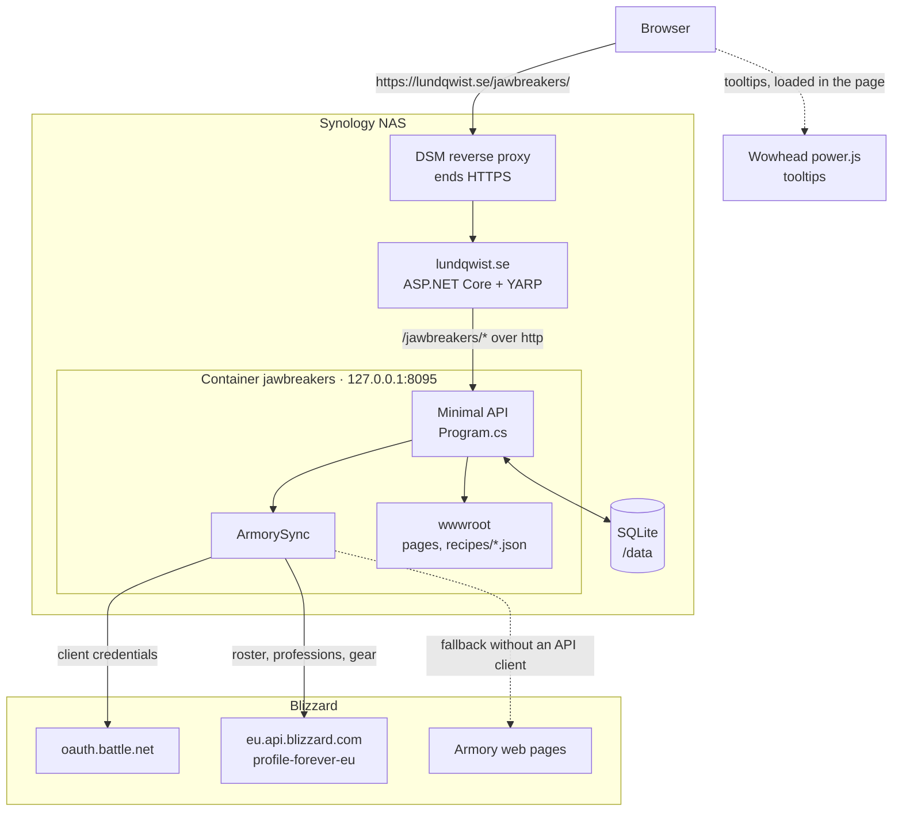
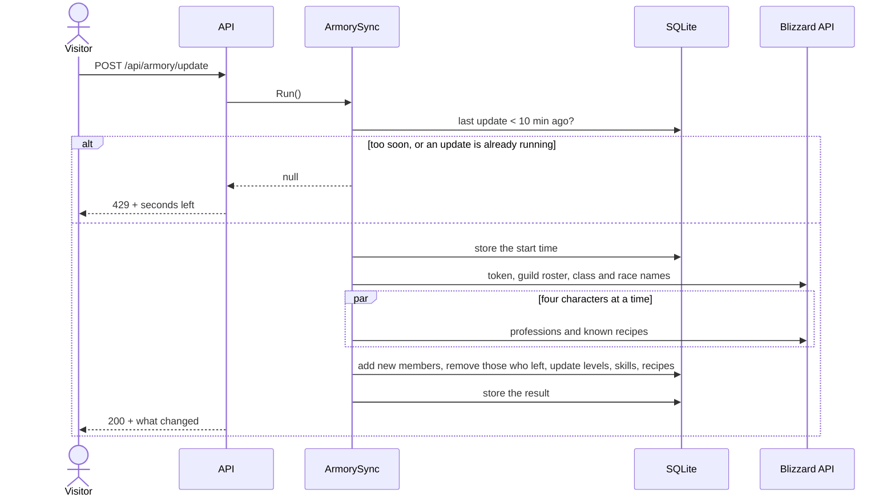

# Jawbreakers Guild

[](https://github.com/Lundqwist/Jawbreakers-Guild/actions/workflows/ci.yml)

The website of Jawbreakers, a Horde guild on the EU PvP ruleset of World of Warcraft: Forever.

**Live:** https://lundqwist.se/jawbreakers/



## What's on it

| Page | What it shows |
|---|---|
| **Guild members** | A button per class with the number of characters. A class opens a window with its characters; a character opens its own window with its picture, gear (Wowhead tooltips), stats and professions, read from Blizzard's API when it is opened and kept for ten minutes. The **Update from the Armory** button refreshes everyone (at most once every ten minutes) |
| **Events** | Upcoming and past guild events: date, time (realm time), starting point in game, description and requirements |
| **Crafting** | Every profession with the characters that have it and their skill level, a button to its leveling guide on [wow-professions.com](https://www.wow-professions.com/forever), and its recipes with materials, Wowhead tooltips and the characters who can make each one |
| **About** | A text about the guild and a history line of what it has achieved |
| **Admin** (`/admin.html`) | Add and edit events, characters (with their profession skill levels), the About text and the history. Signed in, the Crafting page also lets you tick who knows a recipe that doesn't come from a trainer |

There is one admin, who signs in with a password. Visitors don't sign in.

## Built with

- C#, ASP.NET Core 8 minimal API
- Entity Framework Core with SQLite
- Plain HTML, CSS and JavaScript in `wwwroot`: no framework and no build step
- Cookie sign-in for the admin; the password comes from an environment variable, never from a file in the repository
- Docker on a Synology NAS, behind the lundqwist.se site ([Lundqwist/Website2.0](https://github.com/Lundqwist/Website2.0)), which passes `/jawbreakers/...` on to this one
- xUnit integration tests with `WebApplicationFactory`, run by GitHub Actions on every push

## Architecture



A visitor's request goes through the NAS's reverse proxy (which ends HTTPS) and the lundqwist.se site, which passes everything
under `/jawbreakers/` on to this app with YARP. The app only listens on `127.0.0.1`, so it can't be reached any other way.
It serves the static pages and recipe lists itself and answers `/api/...` from SQLite. Blizzard is only called when someone
presses **Update from the Armory** or opens a character window:



### Design decisions

**One small app instead of layers.** All endpoints are in `Program.cs` as a minimal API, the tables in `Data.cs`, and
the only real logic, the Armory update, has its own class. About 20 endpoints and one admin don't need controllers,
repositories and a service layer. Each kind of input is checked in one `Apply...` function that returns an error text or
null, used by both create and update. If the site grows, the endpoint groups (`/api/characters`, `/api/events`, ...)
are the natural seams to split it along.

**SQLite, in a folder that deploys never touch.** The data is small, and only one person (the admin) and the update
write to it. SQLite needs no database server, and a backup is a copy of one file. The database and the cookie
encryption keys both live in `DataDir`, mounted as its own volume, so a deploy can replace the whole app folder and a
restart doesn't sign the admin out. The cost: the schema is made with `EnsureCreated`, which can't change an existing
database, so the two tables added later are created with `CREATE TABLE IF NOT EXISTS`. The next schema change should move
to EF Core migrations.

**Reference data as static files, changing data in the database.** The 2,215 recipes never change, so they are JSON files in
`wwwroot/recipes/` that the browser downloads and caches, not tables. The database only holds what changes: who is in the
guild, their skills and which recipes they know, linked to the files by Wowhead's spell id. The Crafting page puts the
two together in the browser.

**No frontend framework and no build step.** The pages are plain HTML and JavaScript, so there is nothing to compile and
nothing to keep up to date. `common.js` has a small `el()` helper that always puts text in as text, never as HTML, so
names and descriptions typed in the admin page can't inject script. Every address is relative (`api/...`, not `/api/...`),
so the same files work at the root locally and under `/jawbreakers/` live.

**Built to run under someone else's address.** The app gets its path from the `PathBase` setting and answers 404 outside
it. Because the proxies hand the request over as plain http, it reads `X-Forwarded-Proto` so ASP.NET Core knows the
visitor used https, and the admin cookie is always marked `Secure` in production.

**No image to build.** The container runs Microsoft's own `aspnet:8.0` image with the published app mounted read-only.
A deploy is "publish, copy, restart": no Dockerfile, no registry, and nothing on the NAS but the files.

**The Armory update runs when someone asks for it, not on a timer.** A background job would call Blizzard all day for a
guild that looks at the site a few times a week. Instead anyone can press the button, at most once every ten minutes.
The time of the last update is stored in the database, so a restart doesn't reset it, and a `SemaphoreSlim` stops two
presses from running at once. The update is careful with what it trusts:

- it reads everything first and writes to the database at the end, so a failed read leaves the site as it was;
- an empty guild list counts as a failure, since applying it would remove every member;
- when nothing at all could be read, the ten-minute wait is cancelled so people can try again;
- it asks for at most four characters at a time and keeps the OAuth token until five minutes before it runs out.

**Two ways to read the Armory.** With a Blizzard API client the update uses the official API and can add and remove members
and read known recipes. Without one it reads the JSON embedded in each character's public Armory page, which gives less
but means the site works without keys (for example when someone clones the repository). Both return the same `Sheet`
record, so the code that changes the database is shared.

**Character windows are cached, not stored.** Gear and stats are only needed while a window is open, so they are read from
Blizzard on demand and kept in memory for ten minutes. An update clears that cache. Losing it on a restart costs one extra
API call.

**One admin, one password, no user accounts.** Visitors never sign in, so the only account is the admin's. The password
comes from an environment variable; without it, sign-in is off in production (a development run makes a temporary one).
Both the given and the real password are hashed with SHA-256 before a constant-time comparison, so neither the content nor
the length leaks through timing, and a wrong password costs 800 ms. The cookie is `HttpOnly` and `SameSite=Strict`, and
API calls without it get 401 instead of a redirect to a login page.

### What I would change next

- EF Core migrations instead of `EnsureCreated` and hand-written `CREATE TABLE`.
- `ArmorySync` does both fetching and applying in one 500-line class. Splitting it into an API reader, a page reader and
  the code that applies a list of `Sheet`s would make each part easier to test on its own.
- Tests for the Crafting page's JavaScript, which decides who can make a recipe when the API hasn't said.

## Tests

```
dotnet test Jawbreakers.sln
```

`tests/Jawbreakers.Tests` starts the whole site in memory with `WebApplicationFactory`, each test with its own empty
SQLite database in a temporary folder, and talks to it over HTTP like the pages do. Nothing reaches the network:
the site's `armory` HttpClient gets a fake Blizzard (`FakeBlizzard`) that answers the OAuth token, guild roster,
profession and Armory page requests with canned JSON and HTML.

| File | What it checks |
|---|---|
| `ArmorySyncTests.cs` | The Armory update: new members are added and those who left are removed; known recipe names become the Crafting page's spell ids; an empty guild list or a refused API client changes nothing and doesn't start the ten-minute wait; a second press within ten minutes gets 429; without an API client it reads the public pages and never removes anyone |
| `AdminApiTests.cs` | Changes need the admin's cookie; wrong password, signing out; every check on characters, professions and events, and that a refused character isn't half-saved; only characters with a profession can be ticked for its recipes |

GitHub Actions (`.github/workflows/ci.yml`) builds the solution and runs the tests on every push and pull request,
and keeps the results as a `.trx` file.

## Folders

| Path | What |
|---|---|
| `Program.cs` | Startup, sign-in and every API endpoint (`/api/...`) |
| `Data.cs` | The database tables and the shapes of what the API receives |
| `appsettings.json` | The classes, races, event requirements and professions (`Guild`) |
| `seed/` | The first members and their profession skill levels, imported into an empty database |
| `wwwroot/` | The pages, `css/site.css`, `js/common.js` (header, footer, helpers) and `recipes/` |
| `deploy/`, `deploy.ps1` | Docker compose file and the script that publishes to the NAS |
| `tests/Jawbreakers.Tests/` | The xUnit tests (see Tests) |
| `.github/workflows/ci.yml` | Build and test on GitHub Actions |

## Run locally

```
dotnet run --environment Development
```

Without an admin password set, a development run makes a temporary one and prints it in the log.
Set a fixed one with the `Admin__Password` environment variable. Outside development, admin sign-in is off until it is set.

The database is created in `data/` on first start.

## Where the data comes from

- **Members**: `seed/roster.json`, taken from the guild's page on the official Armory on 2026-11-14. Characters below level 10
  have no Armory page, so they have no link and no known race.
- **Profession skill levels**: `seed/professions.json`, from each character's Armory page on the same day.
- **Recipes**: `wwwroot/recipes/<profession>.json` holds every recipe of a profession: spell id, name, category, required skill, source,
  what it makes and the materials, plus the names and icons of the items involved. Taken from
  [Wowhead's WoW: Forever database](https://www.wowhead.com/forever) on 2026-11-14 (2,215 recipes). Each recipe that is learned from an item (a pattern, plans, formula and so on) also carries that item (`recipe`: id, name, quality), matched by name against Wowhead's recipe item lists; the page shows it as a link, and "Learned from trainer" for the others. The page links each recipe
  and material to Wowhead, whose `power.js` script shows the tooltips. The category (armor slot, weapon type, potion, enchant
  slot and so on) comes from the made item's type on Wowhead, or for enchants from the recipe name.

All three are one-time imports.

### Update from the Armory

The Guild members page has an **Update from the Armory** button that anyone can press, at most once every ten minutes (the server
keeps the time of the last update in the database and refuses earlier presses). `ArmorySync.cs` then updates the site and lists what changed.

With a Blizzard API client it uses the official API (OAuth2 client credentials, namespace `profile-forever-eu`):

- the guild's member list: new members are added, members who have left are removed (with their professions and recipes);
- each character's level, class and race;
- each character's profession skill levels and the recipes it knows (characters below level 10 have no profile).

Create the client at https://develop.battle.net (API Access) and give the site its id and secret as the environment
variables `BLIZZARD_CLIENT_ID` and `BLIZZARD_CLIENT_SECRET` (on the NAS: in the `.env` file). They are never stored in the repository.

Without a client it reads the public Armory page of every character already on the site (level, class, race, skill levels)
and cannot add or remove members.

Who can make a recipe: once an update with the API has run, exactly the characters who know the recipe. Before that (or
without a client): for a trainer recipe, everyone with the profession and enough skill; for a recipe from a drop, vendor or
quest, only the characters the admin has ticked.

## Settings

`appsettings.json` → `Guild`: the class lists, the races, the requirement checkboxes on the admin page (`EventRequirements`),
and the professions with their guide links and recipe files (`Professions`).

| Setting | Environment variable | What |
|---|---|---|
| `Admin:Password` | `Admin__Password` | The admin password. Empty outside development = sign-in off |
| `DataDir` | `DataDir` | Folder for the database and the cookie keys (default `data/`) |
| `PathBase` | `PathBase` | The address the site lives under, for example `/jawbreakers` |

## Deploy

The site runs with `PathBase=/jawbreakers`. All addresses in `wwwroot` are relative, so the pages work both there and at the root locally.

`.\deploy.ps1` publishes to `Z:\jawbreakers\app` on the NAS; `deploy\docker-compose.yml` runs it there on `127.0.0.1:8095`.
The admin password goes in a `.env` file next to the compose file (see `deploy\.env.example`). Restart the `jawbreakers`
container afterwards. The `data` folder on the NAS is never touched by a deploy.

## Credits

World of Warcraft and the Armory belong to Blizzard Entertainment; this is a fan site and is not affiliated with Blizzard.
Recipe data, icons and tooltips come from Wowhead. The leveling guides are by wow-professions.com.
